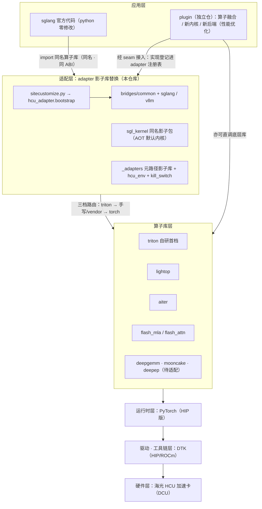
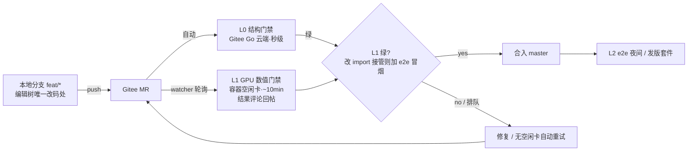
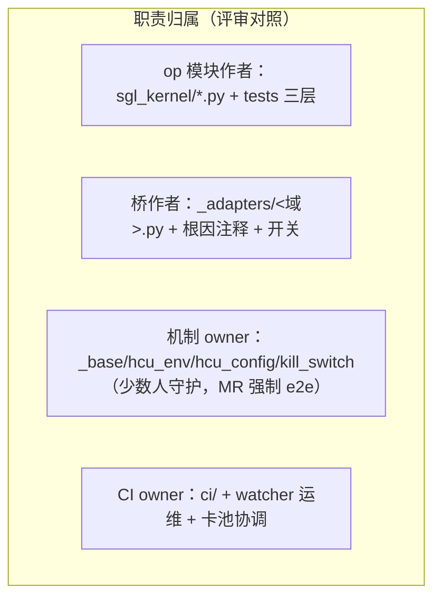

# 架构总览：影子库替换的协调关系

> 本文是架构一页图的文字版（图源：仓库根 [architecture.html](../architecture.html)），
> 讲清 sglang / plugin / adapter / lightop / aiter / mooncake / deepep / deepgemm
> 之间的关系。环境变量见 [env-vars.md](env-vars.md)，实测模型记录见 [models.md](models.md)。

## 1. 定位与核心机制

让社区版 sglang 官方代码的 **python 部分零修改**、直接跑在海光 HCU（DCU/DTK，HIP 路径）上。

**平台语义路线（2026-10-12 定）**：上游的平台判定由 adapter 统一回答
**CUDA 语义**——新模型/新功能在上游总是先落在 `_is_cuda` 分支（NVIDIA 生态
先发），走 CUDA 分支让新模型**不经适配天然入库**，这是卡商追新的关键路径；
**不走 is_hip 分支路线**（个别翻转后会静默改数值语义的判定——如 fp8 fnuz——
由平台层白名单锁定 HIP 语义，见 governance.md §0.5）。

核心机制是**影子库替换**：对 sglang 直接引用的算子库（`sgl_kernel`、`aiter`、
`flashinfer`、`flash_attn`、vllm `_custom_ops` 等）不做调用点改造，而是由本仓库
提供同名/同 ABI 的影子实现并自动接管 import，官方代码拉下来就能跑。
**影子库走路由路线**：守住 CUDA 语义的调用面，HCU 没有的 NVIDIA 库符号按
**四级路由**找归宿——① lightop（vendor 首选，DTK 官方维护）→ ② aiter
（vendor 次选）→ ③ **triton 自研先行**（保证新模型先跑通）→ ④ 响亮 stub
（import 成功、调用报错带指引）。

其余 import 面由三行 `sitecustomize.py` 引导
`hcu_adapter.bootstrap`，再按宿主只安装 `bridges/sglang.py` 或
`bridges/vllm.py`；跨框架启动守卫在 `bridges/common.py`，vendor 库桩仍由
`sgl_kernel/_adapters/` 接管。

宿主入口严格保持以下骨架，不为单一框架另建旁路模块：

```text
sitecustomize.py
hcu_adapter/
  bootstrap.py
  bridges/
    common.py
    sglang.py
    vllm.py
    deepinfer.py
```

其中 vLLM v0.32 通过官方 `vllm.platform_plugins` 与
`vllm.general_plugins` 入口进入 `bridges/vllm.py`；`HcuPlatform` 也在该文件
内按需构造，普通 adapter 启动不提前 import vLLM。官方 ROCm/Triton 已有的
实现直接复用，plugin 独有优化继续留在独立 plugin 仓。
Adapter 是这两组 vLLM 宿主入口的唯一所有者；独立 plugin 不重复注册平台或
general plugin，而是通过 `hcu_adapter.extensions` 入口组提供可选优化。运行时
顺序固定为 **vLLM 版本门禁 → HCU 平台确认 → DTK runtime guard →
扩展发现/激活**。扩展 API 版本当前为 `1`，按 `priority` 和名称确定性排序；
未显式要求的缺失、畸形或不兼容扩展只生成进程内报告，不阻断官方基线路径，
显式要求的扩展或 capability 失败才中止启动。fork 子进程会清空报告和一次性
激活状态，避免继承父进程的结论。
sglang 的统一算子层 `sglang.kernels`（RFC #29630 `BaseFusedOp` 多后端模型）
在 HIP 平台默认 AOT 后端（`forward_aot` → `import sgl_kernel`），同名影
子包即零修改插入点；CUDA 语义模式下算子层照常经 catalog/三档路由取实现。

算子实现不绑定特定后端，按**三档路由**：

1. **triton 先行**——先用 triton 实现，保证正确性（fp32 累加、GPU 路径禁主机同步）；
2. **手写优化 / vendor 封装**——对热点算子做极致优化，不追求自研：可直接封装
   lightop / aiter / flash_attn / flash_mla 等现有算子库；
3. **torch 兜底**——CPU 或不支持 dtype 走 torch 参考，保证 import 与调用永不失败。

## 2. 核心优势

| # | 优势 | 说明 |
|---|---|---|
| ① | 非侵入式维护 · 新模型急速适配 | 影子库与官方 sglang 版本更新**解耦**：升级只对齐算子接口；新模型补齐缺失算子即可急速拉起 |
| ② | 开箱性能 | 官方代码拉起即走 triton / vendor 优选内核，零改造获得可用性能；热点算子持续优化，默认路径越跑越快 |
| ③ | 质量把控集中 | 质量面收敛在 adapter 一层：CI/UT 只测 adapter（契约对拍 + CUDA-graph 回归 + 快关门禁）；**adapter 全绿 ⇒ 官方 sglang 可用** |

## 3. 软件分层

从上到下按软件层画，上层应用、下层支撑：

| 层 | 内容 | 备注 |
|---|---|---|
| 应用层 | **sglang 官方代码**（python 零修改）＋ **plugin**（规划） | plugin：算子融合 / 调度逻辑优化 / 硬件平台无关的优化 |
| 适配层 | **adapter 影子库替换层**（本仓库）：`sitecustomize.py` 薄入口 ＋ `hcu_adapter` 宿主分发/桥 ＋ `sgl_kernel` 同名影子包 ＋ `_adapters` 元路径影子库 | 三档实现路由；配合 skill（`hcu-adapter-dev`）快速排查定位精度问题 |
| 算子库层 | triton（自研首档）· lightop · aiter · flash_mla / flash_attn · deepgemm（待适配）· mooncake / deepep（待适配） | 见 §4 逐项说明 |
| 运行时层 | **PyTorch（HIP 版）** | 张量计算 · 显存管理 · kernel launch；三档中的 torch 兜底也在这层 |
| 驱动 · 工具链层 | **DTK（DCU Toolkit）** | HIP/ROCm 软件栈：驱动 · 编译器 · 运行时 |
| 硬件层 | **海光 HCU 加速卡（DCU）** | 驱动以下才算硬件；gfx93\* 等 arch 探测驱动 adapter 自动裁决 |



## 4. 组件协调关系

### 适配层组件（本仓库）

| 组件 | 职责 | 与其他组件的关系 |
|---|---|---|
| `sitecustomize.py` | PYTHONPATH 自动加载的薄入口 | 只导入并调用 `hcu_adapter.bootstrap.install()`；任何宿主逻辑进入这里都视为回归 |
| `hcu_adapter/bootstrap.py` | 宿主探测和分发 | 显式 `HCU_ADAPTER_HOST` 优先；否则按继承标记、argv、已加载模块、包可用性选唯一宿主；common 先于宿主桥安装 |
| `hcu_adapter/bridges/` | 跨框架与宿主专属 glue | `common.py` 放启动守卫；`sglang.py` 保持既有桥顺序；`vllm.py` 提供 `_custom_ops` ABI 桥并独占 vLLM 0.32 platform/general plugin 入口，在基线门禁后激活可选扩展 |
| `hcu_adapter/extensions.py` | vLLM 优化扩展 API v1 | 从 `hcu_adapter.extensions` entry-point 组发现独立 plugin；负责契约校验、确定性排序、必选 capability 判定和进程内报告，不 import vLLM/Torch/优化包 |
| `sgl_kernel/` | 同名影子包 = `sglang.kernels` 的 AOT 默认内核路径 | elementwise / layernorm / rope / moe / `gemm_fp8`·`gemm_int8` / `flash_mla` emu / `kvcacheio`；API 逐字对齐官方 sgl-kernel；内部按三档路由取 triton / vendor / torch |
| `sgl_kernel/_adapters/` | 元路径影子库（import hook） | `aiter` 真包优先 + 缺口填空；`flashinfer` / `flash_attn` 桩（import 成功、调用响亮报错）；`hcu_env` 环境注册表、`kill_switch` 快关；slimquant / mqa_logits_emu / dsa_topk 等模型级补丁 |

### 算子库层

| 算子库 | 现状 | 说明 |
|---|---|---|
| triton | 自研首档 | 基础算子 triton 起步；fp32 累加、零主机同步；持续手写优化（如 moe gate triton 化排期中） |
| lightop | vendor 封装 | `fuse_silu_and_mul` 已接：`HCU_SILU_MUL_IMPL=lightop` 显式启用，A/B + 图重放压测及格后转正 auto |
| aiter | DTK wheel | 真包优先、桩填空（`fused_clamp_act_mul` / `cp_gather_indexer_k_quant_cache` / `pa_mqa_logits` re-export 等）；custom all-reduce gfx93* 自动拒用（`HCU_AITER_AR=1` 夺回）、`aiter_fa` 快关 |
| flash_mla / flash_attn | emu + 桩 | **fa3 / flashmla 为目标方案**；当前 flash_mla 以 torch emu 顶住（decode=flashmla 后端已首验通过），flash_attn 桩 + 高危压测快关 |
| deepgemm | 待适配 | fp8 paged mqa_logits 经 aiter 桩 re-export；fp8 GEMM 走 `gemm_fp8` triton，本体待接 |
| mooncake | 待适配 | PD 分离/分层 KV transfer 的 `transfer_kv_*` 契约由 `sgl_kernel/kvcacheio.py` torch 移植顶住调用面，mooncake 本体待接 |
| deepep | 待适配 | MoE EP 通信库，仓库内尚无落点（TP1 单机绕过），多卡 EP 时再评估 |

### plugin（独立仓）

与 adapter 分工（判别问句与裁决链见 [governance.md](governance.md) §0/§3）：
adapter 只做**行为还原**（上游在 AMD/CUDA 上有的行为，HCU 补齐到一致）；
**上游没有的能力**归独立 plugin 仓，其目的同样是**性能优化**——算子融合、
专项内核、新调度路径等官方代码没有的功能，只是以"新增能力"形态承载：
经上游 seam 接入 adapter 的注册表与归因设施，**或直接调用 lightop / aiter
等底层库**（不强制穿过 adapter 路由）。plugin 仓的接入同样登记运行时
注册表，保证 `HCU_ADAPTER_DUMP` 看到完整图景。

vLLM v0.32 的接入 seam 是 Adapter 提供的 `hcu_adapter.extensions` entry-point
组。Plugin 只发布 `ExtensionSpec` 和优化实现，不能再声明
`vllm.platform_plugins` / `vllm.general_plugins`，也不能复制版本、平台或 DTK
门禁。这样宿主适配只有一个启动裁决点，plugin wheel 可独立安装/卸载，且无
plugin 时仍保持官方 vLLM 基线路径可启动。

## 5. 横切机制

- **配置裁决**（`hcu_env.py` + `hcu_config.py`）：显式 env > `hcu_adapter.yaml`
  > 自动规则（arch/wheel 探测）> 默认值；启动日志打印每个生效值及来源，
  正确部署零环境变量。手册见 [env-vars.md](env-vars.md)、配置层见
  [config.md](config.md)。
- **运行时注册表**（`_adapters/registry.py`）：每算子活跃实现+安装机制登记，
  启动日志 `HCU adapter runtime:` 逐项打印；`HCU_ADAPTER_DUMP=路径` 出 JSON
  供归因与配置级二分。规约见 [governance.md](governance.md) §4。
- **快关**（`kill_switch.py`）：`HCU_DISABLE_OPS=aiter_ar,aiter_fa` 一翻开关绕开
  疑似算子复跑，高危 vendor 算子接入即配压测 + 快关。
- **质量设施**：契约对拍官方 CUDA 核语义（gate 排序/tie-break、padding/cumsum 契约）、
  CUDA-graph capture-replay 变输入探针、精度问题四级快速定位
  （`tests/tools/run_triage.py`）。开发规约见
  [skills/hcu-adapter-dev/SKILL.md](../skills/hcu-adapter-dev/SKILL.md)。

## 6. 运行时调用链

```
python -m sglang.launch_server
  └─ PYTHONPATH = hcu-sglang-adapter : sglang/python
       └─ sitecustomize.py → hcu_adapter.bootstrap.install()
            ├─ bridges/common.py（env 摘要 / NCCL topo / tvmffi 守卫）
            └─ bridges/sglang.py（只安装 sglang 宿主桥，既有顺序不变）
                 └─ sglang.kernels（BaseFusedOp）--forward_aot--> sgl_kernel 影子包
                 ├─ triton 自研核（首档）
                 ├─ vendor 封装（lightop / aiter / flash_mla …，hcu_env + 快关门控）
                 └─ torch 兜底
            └─ 其余 import 面：_adapters 元路径桩接管 aiter / flashinfer / flash_attn
                 └─ PyTorch（HIP）→ DTK（驱动·编译·运行时）→ 海光 HCU（DCU）
```

---

# 协作与长期维护（多人版）

以上 §1–§6 是机制视图；以下面向"多人协作、长期升级"的组织视图：目录怎么读、
设计目标如何收敛、已知架构债与演进计划、以及改动如何进门禁。

## 7. 目录导览

```
hcu-sglang-adapter/
├─ sitecustomize.py            # 三行自动加载入口
├─ hcu_adapter/
│   ├─ bootstrap.py            # 宿主探测 + common/host 分发
│   └─ bridges/                # common / sglang / vllm / deepinfer
├─ sgl_kernel/                 # 同名影子包 = sglang 的 AOT 默认内核路径
│   ├─ elementwise/layernorm/rope/allreduce/flash_attn.py …   # op 模块（三档路由）
│   ├─ gemm_fp8.py / gemm_int8.py / flash_mla.py / kvcacheio.py
│   └─ _adapters/              # 元路径影子库 + 机制层 + 模型级桥（见下三分类）
├─ ci/                         # L0 结构门禁 / L1 GPU 门禁 / MR watcher
├─ tests/
│   ├─ test_ops_cpu.py         # torch 兜底路径（任何机器）
│   ├─ kernels/                # GPU 单测 + parity + graph capture 回归
│   ├─ vendor/                 # 高危 vendor 压测 + 快关 gate
│   ├─ adapter/                # 接管机制本身（裁决链/桩行为）
│   ├─ bench/                  # 性能
│   └─ tools/                  # 门禁/探针/物料/调试（命名语法见其 README）
├─ docs/                       # architecture / env-vars / models / cookbook / config / ci
├─ skills/hcu-adapter-dev/     # 开发规约 skill（AI 协作与人的排查手册）
├─ hcu_adapter.yaml            # 部署层配置示例（BACKEND_CATALOG 的使用面）
+ docs/board.md               # 看板+协作规约（原 CONTRIBUTING 并入）
└─ architecture.html           # 本文档配图（自包含，浏览器直开）
```

`_adapters/` 内部三分类（新文件按此归位）：

| 类 | 文件 | 说明 |
|---|---|---|
| 机制层 | `_base.py` `hcu_env.py` `hcu_config.py` `kill_switch.py` | LibStubFinder 双通道（extras 填空 / overrides 夺回 / post_hooks 后处理 / guards 快关）、环境注册表、配置裁决、快关——**改这些 = 全仓生效，MR 需 e2e 冒烟** |
| 域桥 | `aiter_moe.py` `prefill_cp.py` `slimquant.py` `triton_ar.py` `deep_gemm_*.py` `dsa_topk.py` `mqa_logits_emu.py` `hadamard.py` | 每座桥解决一个上游判定/能力缺口，必须带根因注释 + 开关 |
| vendor 桩目录 | `aiter/` `flash_attn/` `flashinfer/` | 真包优先、缺口填空（aiter）；import 成功、未实现调用响亮报错（flashinfer/flash_attn） |

## 8. 设计目标收敛（不变量）

多人协作下容易被局部最优侵蚀的四条不变量，评审时对照：

1. **sglang python 零修改**——一切适配经 import 面进入：影子包 / 元路径桩 /
   `hcu_adapter` 宿主桥。出现"顺手改一下上游文件"的冲动时，答案永远是先找
   上游 seam，再按治理边界加桥。
2. **三档路由**（triton 首档 → vendor 封装 → torch 兜底）——正确性优先，
   性能在档内演进；任何 op 至少有 torch 兜底保证 import 永不失败。
3. **配置裁决链** env > `hcu_adapter.yaml` > arch/wheel 自动探测 > 默认值；
   `BACKEND_CATALOG` 四状态（production/validated/candidate/planned）是后端
   成熟度的唯一事实源，L0 交叉一致门禁锁死 REGISTRY↔docs↔catalog↔yaml。
4. **质量收敛在 adapter 层**——CI/UT 只测本仓（契约对拍 + graph 回归 +
   快关门禁）；"adapter 全绿 ⇒ 官方 sglang 可用"，不背上游的测试债。

> 推广协作前请先读 [governance.md](governance.md)：双仓边界（adapter=行为
> 还原，plugin 仓=新能力/性能优化）、实现层授权边界、active/ref 角色模型、
> seam→rebind→text-patch 裁决链、运行时注册表与 HCU_ADAPTER_DUMP 归因流。
> 它的三条 HARD 规则已并入 L0（`glue-numerics` / `text-patch` /
> `registry-ops`）。

## 9. 已知架构债与演进计划

| # | 债 | 现状 | 计划 |
|---|---|---|---|
| 1 | `bridges/sglang.py` 仍是 3000+ 行顺序化遗留链 | 薄入口与宿主隔离已完成，但 sglang 域内桥仍共享命名空间 | **分阶段拆分**（见下），每阶段容器 e2e 复验后合入 |
| 2 | `tests/tools/` 90+ 文件 | 已用 `_test_/_probe_/_launch_/_dbg_` 前缀语法事实上分层；`_dbg_` 用完即删（2026-10 已清 12 个结案取证脚本） | 语法固化为 README 规约（不搬迁：路径被 CI/文档/记忆引用，搬迁成本>收益） |
| 3 | `_adapters/` 混三类文件 | 语义分类未显式 | §7 三分类表归位约定：新桥一律独立文件，不再长入 sitecustomize |
| 4 | 双树漂移（本地编辑树 vs 容器执行树） | elementwise API 漂移实 bug 一次 | 纪律（board.md「协作与分支规约」共享节点节）+ CI worktree 作为唯一第二执行面 |

**宿主桥后续拆分计划**（薄 `sitecustomize` 与宿主分发已落地；目标终态见
governance.md §0——adapter 职能 = 影子库/算子路由/质量检测的**行为还原**，
上游没有的功能归**独立 plugin 仓**（经上游 seam/注册机制接入），
`sitecustomize` 保持三行入口）：

- **P1（进行中）**：把纯函数桥（int8/fp8 重绑定、flashinfer 构造桩等）从
  `hcu_adapter/bridges/sglang.py` 抽到单职责模块（install() + 开关 +
  registry.register）；RMSNorm ABI 桥已归位 `bridges/vllm.py`。行为等价，
  import 顺序不变。
- **P2（需 e2e）**：判定词类桥（model_overrides wrap、CP gate 等）迁到
  `_adapters` post_hooks，缩短 `bridges/sglang.py`。
- **P3**：P2 全量 e2e（cookbook 冒烟套件）通过后，宿主桥只保留顺序编排，
  新实现体禁入——这已从计划升格为规约（governance §0 / board.md 协作规约
  §3b），**现在起新需求先过双仓判别：行为还原才进本仓，功能扩展落
  plugin 仓**；本仓的新域桥也直接落 `_adapters/<域>.py`，不等 P1-P3 完成。

## 10. 协作流程与门禁

分支模型、checklist、节点纪律见 [board.md](board.md)「协作与分支规约」节；
CI 细节见 [ci.md](ci.md)。一张图看 MR 全程：




